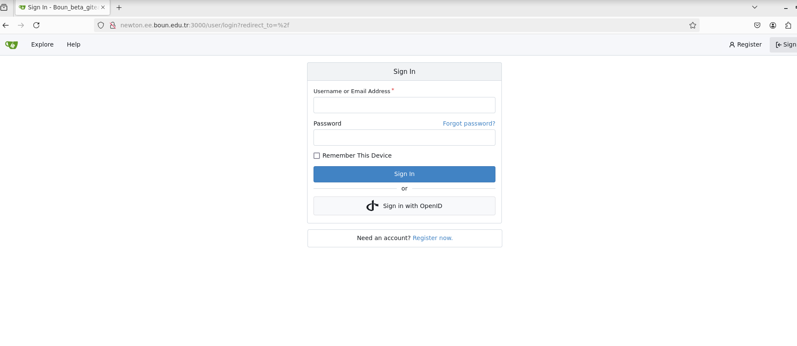
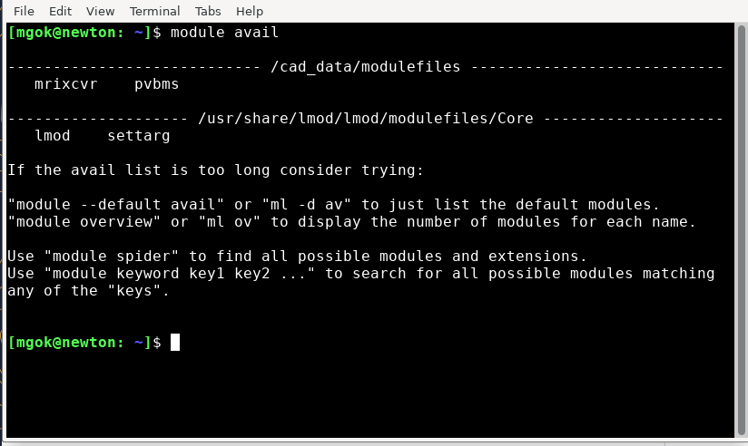
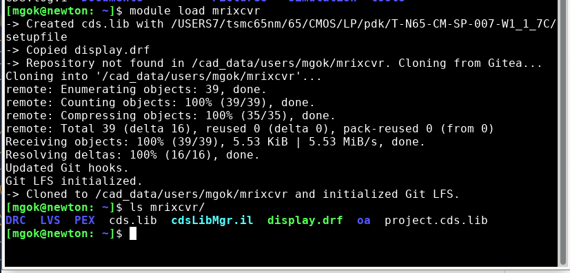
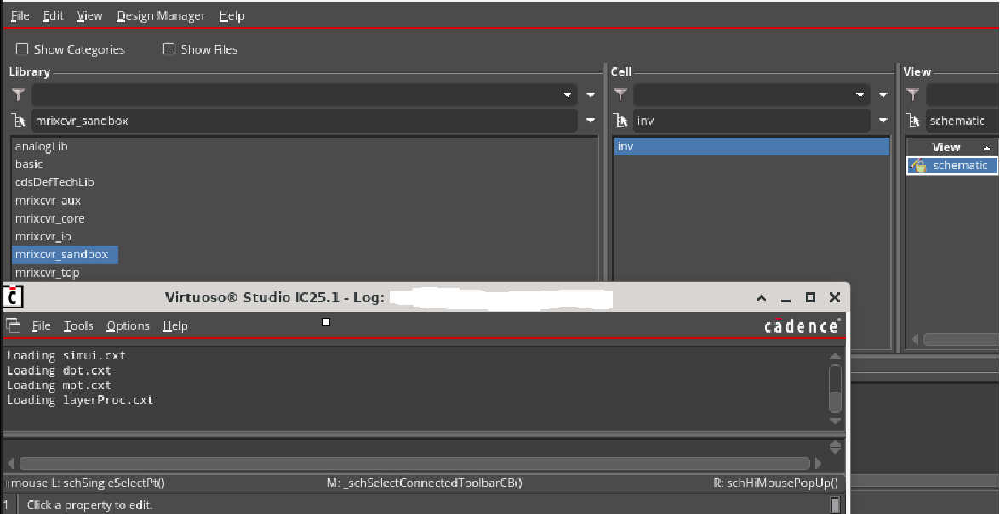
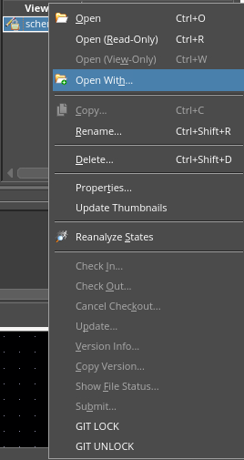

# BetaLab Cadence Usage Guide

This process is valid for both the Hartley and Newton servers.

> Please learn the basics of Git before using the shared repositories. An
> example video is available [here](https://www.youtube.com/watch?v=y-an0v208A0).

You can access the repositories from the Gitea page:

**<http://newton.ee.boun.edu.tr:3000>**



Sign in with your LDAP username and password.

## How to use in servers
After signing in to Newton or Hartley, run the following command to see the
project environments available to you:

```bash
module avail
```



After that, load the project environment with:

```bash
module load <project_name>
```

For example:

```bash
module load pvbms
module load mrixcvr
```



This command sets up the Cadence environment and clones the corresponding
Gitea repository into `~/<project_name>`. On subsequent uses, it loads the
required tools, such as Virtuoso and Calibre, without cloning the repository
again.

When you are finished using the module, you can run `module purge` to unload
all modules, or `module unload <project_name>` to unload only that project.

## Project directory structure

Each project directory contains the Cadence design files and project
configuration. The `DRC`, `LVS`, and `PEX` directories are provided for
design-rule checking, layout-versus-schematic checking, and parasitic
extraction runs:

```text
mrixcvr/
├── DRC/
├── LVS/
├── PEX/
├── cds.lib
├── cdsLibMgr.il
├── display.drf
├── oa/
└── project.cds.lib
```

Run DRC, LVS, and PEX inside their respective directories. Files generated
under `DRC`, `LVS`, and `PEX` are not tracked by Git, so they will not be
pushed to the repository.



The `oa` directory contains the project's Cadence libraries. Libraries other
than `<project_name>_sandbox` are tracked by Git. The
`<project_name>_sandbox` library is not tracked, so feel free to use it for
custom experiments without pushing those changes to the repository.

## Making changes (always pull especially before push)
Before starting any design work, update your local repository:

```bash
git pull
```

You can then create and edit cells as needed. Each cell has two additional
buttons for Git locking and unlocking:



Click **Git Lock** on a cellview before editing it. This prevents other users
from modifying the same cell. You can check which files are locked with:

```bash
[mgok@newton: ~/mrixcvr]$ git lfs locks
oa/mrixcvr_aux/schmit/schematic/sch.oa	johndoe	ID:7
```

Other users cannot acquire a lock on a Git-tracked cell until you release it.

After finishing your work, check and stage the changes:

```bash
git status
git add <files>
```

Pull the latest changes, then create an atomic commit and push it:

```bash
git pull && git commit -m "Describe what was changed" && git push
```

After pushing your changes, right-click the cellview and select **Git
Unlock** so other users can use it.

Please feel free to add your own spice to make it even more delicious!
